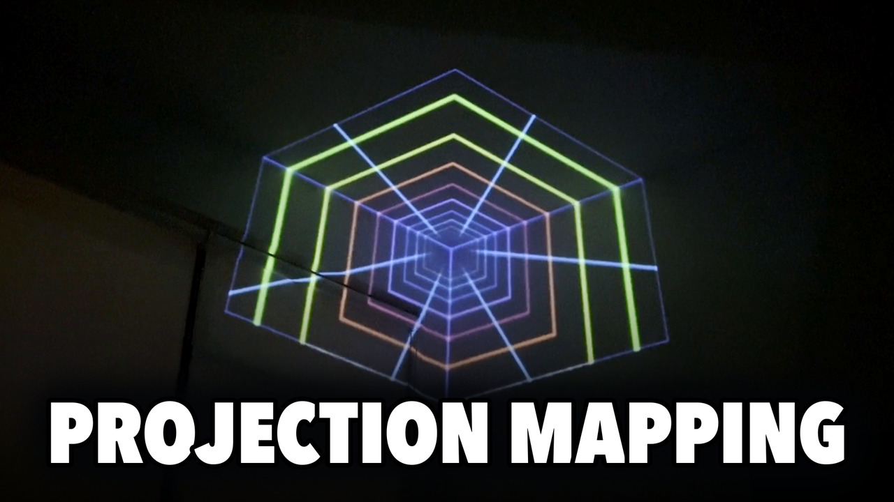

# ProjectionMapping

Projection mapping on Raspberry Pis, each driving a low-cost projector over
HDMI. The main project turns a room corner (two walls and the ceiling) into a
3D stage: a Pi Zero 2 W renders live scenes from the viewer's point of view, so
the corner seems to open up, fill with water, grow cubes, or become a night sky
with Santa crossing the moon. Everything is controlled from a phone or laptop.

## Demo

**[Watch the demo on YouTube](https://youtu.be/vNaMZKivIM8)**: every scene, recorded in a dark room.

## How it works

- **Corner calibration.** In the web UI you drag four dots onto the corner as
  the projector shows them: the vertex, and one point on each seam. From those
  the Pi works out the projector's pose and a viewer position, and builds a
  projector-to-viewer mesh.
- **Live rendering (`skyd`).** A small C renderer (KMS/DRM, GLES2, no desktop
  and no browser) ray-traces each scene from the viewer's eye onto the three
  real surfaces, masked to a room-aligned shape. Scenes are GLSL fragment
  shaders; physics for the moving-object scenes runs once per frame on the CPU.
- **Control (`projd`).** A Go server with a tabbed web UI: projector input and
  power, demos and playlists, the night sky (snow, moon, Santa), video, corner
  calibration and flat-video warp. Calibration uses a WebSocket with
  acknowledgement-based flow control, so the pointer and dots follow you live.
- **Video in the corner.** Pick a video on the Pi and it plays on a screen
  floating in the middle of the corner, with sound through the projector.

## Scenes

About 30 scenes in four loops, plus a "top 12" playlist you choose in the UI:

- **Loop 1:** scanning planes, membrane push, cube break-out, corner flip,
  window, relief panels, water fill, corner spin, night sky.
- **Loop 2:** spotlight reveal, X-ray wall, bouncing balls, vortex, pin screen,
  puzzle cube, string art, liquid metal, snowfall, infinite corner.
- **Loop 3 (physics across all three faces):** marble run, breakout, gravity
  carousel, portal juggle, crawlers.
- **Neon:** neon grid, wire tunnel, rotor grid, equalizer.

What made the best scenes work (and the Pi Zero performance lessons) is in
[`pi-mapper/docs/corner-scene-design.md`](pi-mapper/docs/corner-scene-design.md).
The scene briefs are in [`corner-illusions-demo.md`](corner-illusions-demo.md),
[`-2`](corner-illusions-demo-2.md) and [`-3`](corner-illusions-demo-3.md).

## What's here

| Path | What it is |
| --- | --- |
| [`pi-mapper/cmd/projd/`](pi-mapper/cmd/projd/) | The control server and web UI for the headless Pi. |
| [`pi-mapper/skyd/`](pi-mapper/skyd/) | The live renderer (`skyd.c`, `sims.c`) and all scene shaders. |
| [`pi-mapper/corner/`](pi-mapper/corner/) | Corner geometry tools, including structured-light calibration with a webcam. |
| [`pi-mapper/headless/`](pi-mapper/headless/) | Browser-free setup: USB keyboard gadget for the projector, corner-pin warp. |
| [`pi-mapper/deploy/`](pi-mapper/deploy/) | systemd units. |
| [`pi-mapper/docs/`](pi-mapper/docs/) | Guides: headless Pi Zero setup, projector power/Wi-Fi/IR notes. |
| [`pi-mapper/`](pi-mapper/) (`mapd`) | The earlier browser-based mapper for a Pi 5. See its [README](pi-mapper/README.md). |
| [`pi5-projection-mapping-handoff.md`](pi5-projection-mapping-handoff.md) | The original brief. |

## Requirements

- Raspberry Pi Zero 2 W (or Pi 5), a projector with HDMI input, a microSD card
- On the Mac: Go 1.23+, ffmpeg, and Raspberry Pi Imager
- On the Pi: Raspberry Pi OS Lite, mpv, ffmpeg, and the GLES2/GBM development packages to build `skyd`

## License

MIT. See [LICENSE](LICENSE).
